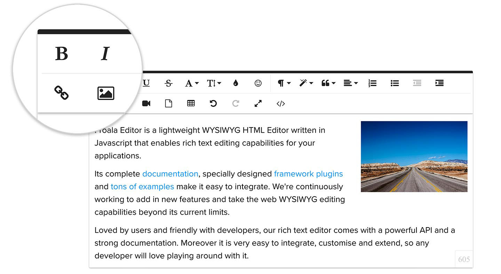

# [Froala](https://www.froala.com/wysiwyg-editor) - Rich Text Editor

### A rich text editor built for people, with AI you control.

[](https://www.npmjs.com/package/froala-editor)
[](https://www.npmjs.com/package/froala-editor)



## What is Froala?

Froala adds a complete writing experience to any web product: content management systems, learning platforms, email and page builders, help desks, CRMs and document tools.

**End users** get familiar formatting, Word import and export, real-time collaboration with track changes, and AI assistance. **Developers** skip building and maintaining an editor of their own. Content stays in-house, and AI requests go only to the model you choose.

The editor works with React, Angular, Vue, Svelte and plain JavaScript, and [many more](https://www.froala.com/wysiwyg-editor/docs/framework-plugins/).

## Install with npm

```bash
npm install froala-editor
```

```js
import FroalaEditor from 'froala-editor';
import 'froala-editor/js/plugins.pkgd.min.js';
import 'froala-editor/css/froala_editor.pkgd.min.css';

new FroalaEditor('#froala-editor', {
  key: 'your-license-key' // see "License key" below
});
```

## Quick start (CDN)

Two files, one element, one line of JavaScript:

```html
<!doctype html>
<html lang="en">
<head>
  <meta charset="utf-8">
  <meta name="viewport" content="width=device-width, initial-scale=1">
  <title>Froala Editor - Quick start</title>
  <link href="https://cdn.jsdelivr.net/npm/froala-editor@latest/css/froala_editor.pkgd.min.css" rel="stylesheet">
</head>
<body>
  <div id="froala-editor"></div>

  <script src="https://cdn.jsdelivr.net/npm/froala-editor@latest/js/froala_editor.pkgd.min.js"></script>
  <script>
    new FroalaEditor('#froala-editor');
  </script>
</body>
</html>
```

In production, pin a version instead of `@latest` (for example `froala-editor@5.6.0`) and use the same version for both files.

## What's in the package

| File | What it brings |
| --- | --- |
| `js/froala_editor.pkgd.min.js` | The editor and every plugin, in one file. |
| `css/froala_editor.pkgd.min.css` | Styles for the editor and every plugin, in one file. |
| `js/froala_editor.min.js` | The editor core only, without plugins. This is the package's `main` entry. |
| `css/froala_editor.min.css` | Styles for the editor core only. |
| `js/plugins.pkgd.min.js` / `css/plugins.pkgd.min.css` | Every plugin, to load next to the core files. |
| `js/plugins/*.min.js` / `css/plugins/*.min.css` | One plugin per file, for selective loading. |
| `js/third_party/*.min.js` / `css/third_party/*.min.css` | Integrations with third-party services, such as Embedly and the image editors. |
| `css/froala_style.min.css` | Styles for showing edited content outside the editor. |
| `css/themes/*.min.css` | Optional editor themes. |

## Selective loading

To build your editor with fewer plugins, load the core files plus only the plugins you use:

```js
// Editor core (required)
import FroalaEditor from 'froala-editor';

// Plugins
import 'froala-editor/js/plugins/align.min.js';
import 'froala-editor/js/plugins/image.min.js';

// Core styles, plus styles for the plugins that have their own
import 'froala-editor/css/froala_editor.min.css';
import 'froala-editor/css/plugins/image.min.css';

new FroalaEditor('#froala-editor', {
  pluginsEnabled: ['align', 'image']
});
```

Plugin names and options: [Plugins documentation](https://www.froala.com/wysiwyg-editor/docs/plugins/).

## Frameworks

- [React](https://www.froala.com/wysiwyg-editor/docs/framework-plugins/react/)
- [Angular](https://www.froala.com/wysiwyg-editor/docs/framework-plugins/angular/)
- [Vue](https://www.froala.com/wysiwyg-editor/docs/framework-plugins/vue-js-3/)
- [Svelte](https://www.froala.com/wysiwyg-editor/docs/framework-plugins/svelte/)
- [All integrations](https://www.froala.com/wysiwyg-editor/docs/framework-plugins/) (Django, Rails, Symfony, WordPress and more)
- Server-side SDKs for PHP, Node.js, .NET, Java and Python: [Server SDKs](https://www.froala.com/wysiwyg-editor/docs/sdks/)

## Demos and examples

- [Live demo](https://www.froala.com/wysiwyg-editor)
- [Inline demo](https://www.froala.com/wysiwyg-editor/inline)
- [Collaborative editing demo](https://froala.com/collaborative-editing-demo/)
- [All examples](https://www.froala.com/wysiwyg-editor/examples)

## Browser support

The latest two versions of Chrome, Edge, Firefox, Safari and Opera, plus Safari on iOS and Chrome, Firefox and the default browser on Android.

## Documentation and support

- [Documentation](https://www.froala.com/wysiwyg-editor/docs)
- API: [Options](https://www.froala.com/wysiwyg-editor/docs/options/), [Events](https://www.froala.com/wysiwyg-editor/docs/events/), [Methods](https://www.froala.com/wysiwyg-editor/docs/methods/)
- [Changelog](https://froala.com/wysiwyg-editor/changelog/)
- [Help Center](https://wysiwyg-editor.froala.help/)

For questions or help integrating the editor, [contact support](https://froala.com/contact/) instead of opening an issue.

## Reporting issues

[GitHub Issues](https://github.com/froala/wysiwyg-editor/issues) is the official bug tracker. To help us fix a bug quickly:

1. Check that you're on the latest version (see the [changelog](https://froala.com/wysiwyg-editor/changelog/)).
2. Include steps to reproduce, ideally a minimal runnable example (CodePen, JSFiddle or StackBlitz).
3. Name the browser and operating system where it happens.

## Licenses

Froala is a professional commercial component with a 30-day free trial. Every Froala plan is self-hosted and includes all plugins, AI Assist and collaboration, with unlimited editor loads, users and developers.

- **30-day trial.** It's free. No registration or account is required. All features are unlocked, with just a small watermark. It's not intended for production use.
- **Commercial license.** It may come with unlimited products and domains on one wildcard key and cover SaaS, OEM and on-premise distribution.

Need source code, volume pricing or custom terms? [Contact sales](https://froala.com/contact/?department=Sales). Find more details on the [pricing page](https://cart.froala.com) or in the [license terms](https://www.ideracorp.com/legal/Froala#tabs-2).

## License key

Froala requires a key, passed in the `key` option. Start with the trial key if you're just trying the product or comparing it with other solutions.

```js
new FroalaEditor('#froala-editor', {
  key: 'TRIAL-LICENSE-KEY-FOR-FROALA-NOT-FOR-PRODUCTION-USE', // 30-day trial key or your commercial key
});
```

Before you go live, replace the trial key with your commercial key. License information is available in the License file in the root folder.

Without a valid key the editor shows a notice in the bar at the bottom, under "Powered by Froala", and writes the same text to the browser console once. The text says whether the key is missing, a trial, invalid or expired, and is translated with the editor's language. A valid key shows nothing.

On a local host (`localhost`, `127.x.x.x`, `0.0.0.0`) you get the same notice as on a public site if there is no key, the key is a trial key, or the key has expired. A key that is still valid (a term key also during its 15 day grace period) gives a clean editor there, so licensed developers are not affected.

---

Built with ❤️ by the Froala team
